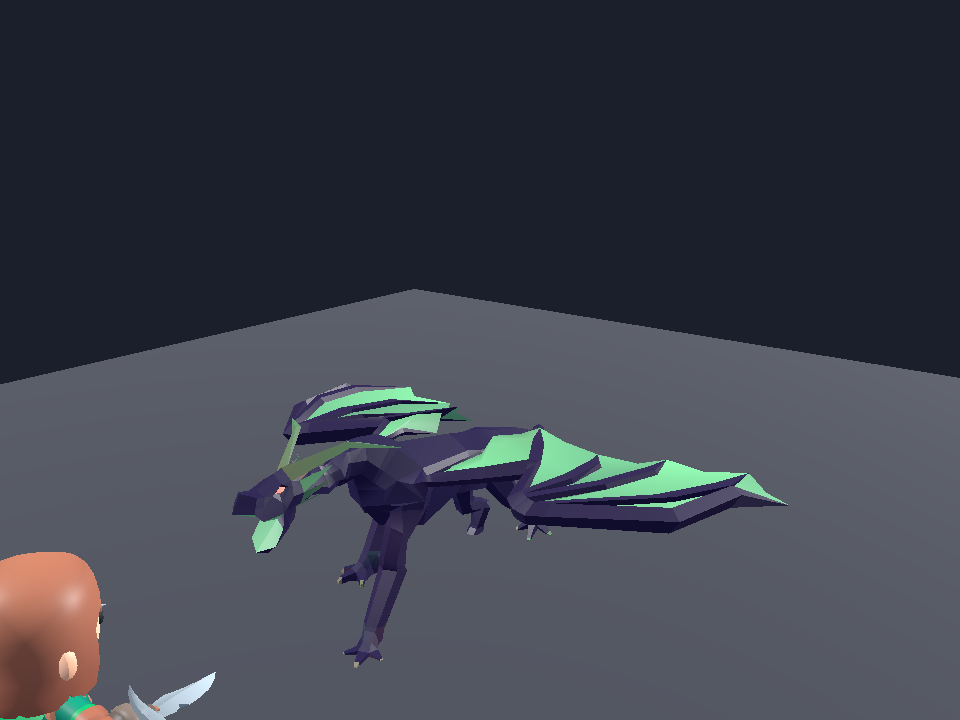

# 龙的资源调研 —— 最终结论（西方奇幻龙 · 免费/开源 · 最好带攻击动作）

> 面向项目：`demo-1`（Godot 4.7 第三人称 + 沙盒经营 + 战斗）
> 风格基线：当前占位美术 = **KayKit Character Pack: Adventurers（CC0）**，低多边形 + 平涂贴图，单 GLB 内嵌动画
> 调研日期：2026-10-01　｜　调研方式：两条独立取证线 + 交叉对抗式复核 + Godot 4.7 无头/带窗口实测
>
> **后续进展（同日晚）**：用户拍板「CC0 那批拿来做怪物，CC-BY 的龙留作主角/小兵方（暂不动）」。
> **CC0 怪物已落地**：改用 **Quaternius Ultimate Monsters**（50 个全动画怪物，CC0），
> 野怪三档换皮完成 —— 见本文档末尾《六、已落地的怪物换皮》一节。

---

## 一句话结论

**首推 [bocdagla · Low Poly Dragon Model 3D](https://bocdagla.itch.io/low-poly-dragon)（itch.io，CC-BY，免费免登录）**：它是本次全部候选里**唯一动画覆盖能直接进本仓库状态机**的龙 —— 自带 `Idle_loop` / `Walk_menacing_loop` / `GroundToFly` / `Flying_loop` / `Attack` / `AttackPose`，2004 三角面、76 骨骼、贴图内嵌、单 GLB，且作者明确说是为 Godot 做的（带 tip bones 方便 IK）。
**代价**：许可要求署名（CC-BY），且**没有死亡动画**（用 `AttackPose` 定格 + 项目 v16 贴图溶解兜住即可）。




---

## 一、候选总表（全部经过文件字节或页面原文核实）

| # | 模型 | 来源 | 许可 | 攻击动作 | 有走路/待机？ | 面数 / 骨骼 | 下载门槛 | 结论 |
|---|---|---|---|---|---|---|---|---|
| **4** | **Low Poly Dragon Model 3D** | [itch.io/bocdagla](https://bocdagla.itch.io/low-poly-dragon) | CC-BY（描述正文，无版本号） | ✅ `Attack` + `AttackPose` | ✅ **`Idle_loop` / `Walk_menacing_loop` / `GroundToFly` / `Flying_loop`** | 2004 / 76 | **免登录**（已脚本直连走通） | ⭐ **首推** |
| 1 | Dragon（Animated Monster Pack） | [quaternius.com](https://quaternius.com/packs/animatedmonster.html) | **CC0**（包内 License.txt 原文） | ✅ `Dragon_Attack` + `Dragon_Attack2` | ❌ 只有 `Dragon_Flying` | 1344 / 27 | 免登录直连 GLB | 飞行怪/BOSS 可用 |
| 2 | Dragon / Dragon_Evolved（Ultimate Monsters） | [quaternius.com](https://quaternius.com/packs/ultimatemonsters.html) | **CC0**（包内 License.txt 原文） | ✅ `Headbutt` + `Punch` | ❌ 只有 `Flying_Idle` | 4562 面 / 13 骨骼 | 公开 Drive 目录（**匿名可直连**） | CC0 里唯一带 `Death` 的；但造型是**大头 Q 版浮空龙、没有四足站姿** |
| 3 | YellowDragon（Cute Monsters） | [quaternius.com](https://quaternius.com/packs/cutemonsters.html) | CC0（仅包页，无随包许可） | ✅ `Bite_Front` | ❌ 只有 `Flying` | 1592 / 17 | Drive 目录 | 造型是 Q 版浮空大头，风格差距大 |
| 5 | Wyvern | [Sketchfab/DibArts](https://sketchfab.com/3d-models/wyvern-b3b83f40265347dd90e4666c3e2a843c) | CC-BY 4.0 | ✅ `Attack.new` | ✅ `Standing` / `Walking` / `Running` / `Flying` | 1154 面 | **需登录 Sketchfab** | 动画最全套，但下载要账号；`isRigged=false` 待实测 |
| 6 | Simple 3D Dragon Model | [OpenGameArt/MattBas](https://opengameart.org/content/simple-3d-dragon-model) | **CC-BY-SA 4.0**（传染性） | ❌ **无攻击** | ✅ `Idle-loop` / `Walk-loop` / `Run-loop` / `Flying-loop` | 2698 / 65 | 免登录 | 有位移没攻击，且 ShareAlike 需法务确认 |
| — | 黑名单若干 | Sketchfab | 字段写 CC-BY 但描述写「非商用」/ 手游拆包 / 上传者未知 | — | — | — | — | ❌ 见 `wide-scan.md` C 级 12 条 |

> 上表每一行的「许可」「动画名」「面数」都来自**逐字节解析真实文件**（glTF/GLB/FBX/License.txt），不是搜索摘要或页面宣传。例外：候选 5 的动画驱动性因需登录**无法核实**，已在 `verification.md` §9 标明。
> 候选 2 的面数/骨骼数取自**官方 Drive `.gltf`**（4562 面 / 13 骨骼）；`poly.pizza` 直链镜像版是**降级版**（翼尖与颈部骨骼在飞行动画里完全不动），别用镜像版评估动画质量。

---

## 二、这次的真正取舍（请重点看这一段）

调研两条线各自独立得出同一个结论：

> **「带攻击动作」和「有地面位移动画」在免费资源里几乎不可兼得。**

- **CC0 阵营（三个 Quaternius 龙）**：许可最干净（可商用、免署名），攻击动作真实（已双源交叉验证），但**全部只有飞行动画，没有地面待机/行走**。直接放进本仓库的 `Pawn` 会变成「龙贴地滑行」。
- **有完整位移的阵营**：bocdagla（Idle/Walk/Attack 全有，CC-BY 需署名）；MattBas（Idle/Walk/Run 全有但**没有攻击**，且 CC-BY-SA 有传染性）。
- **两者都想要的**：Sketchfab 的 DibArts Wyvern（Standing/Walking/Running/Flying/Attack 五条齐），但**必须登录才能下载**。

**所以三条现实路线：**

| 路线 | 做法 | 适合 |
|---|---|---|
| **A. 一条龙当两只用（推荐）** | 用 bocdagla 龙做**地面怪/精英/头目**（Idle+Walk+Attack 齐），用 Quaternius 龙做**飞行单位**（Flying+Flying_Idle 天然） | 想立刻看到效果、不想登录/不想改许可 |
| **B. 全量走 CC0** | 三个 Quaternius 龙任一，接受「无走路动画」；移动时用 `Flying` 顶替 `move`，或从 KayKit 人形动画重定向。**注意官方 Ultimate Monsters 龙渲出来是「大头 Q 版浮空龙」，不是四足龙**（见 `poc/preview_quaternius_side.png`）——想当飞行怪可以，想当四足巨龙不行 | 商用必须 CC0、零署名负担 |
| **C. 一步到位** | 注册 Sketchfab 账号下 DibArts Wyvern，实测 `isRigged=false` 是否真能驱动网格（**判据**：Godot 里看 AnimationPlayer 轨道目标是否 ≥3 个节点，若全指向单一根节点则作废） | 愿意登录换最全套动画 |

---

## 三、首推方案落地清单（bocdagla 龙）

### 实测客观数据（Godot 4.7 无头/带窗口解析 `Dragon2.glb`）

| 项目 | 实测值 |
|---|---|
| 三角面 | **2004**（`accessors[].count//3` 实算） |
| 骨骼 | **76 关节**（含 `Head.Tip` / `LegFront_L.Tip` 等 IK tip bones） |
| 材质 | 1 个，**albedo 贴图内嵌**（4×4 调色板 PNG，另有 3 张 `palette_alt_*.png` 可换色） |
| 原始包围盒 | 7.313 × **10.451** × 11.464（厘米量级，需缩放到项目尺寸） |
| 动画 | **6 条**：`Attack`(0.92s) / `AttackPose`(0.42s) / `Flying_loop`(1.67s) / `GroundToFly`(0.83s) / `Idle_loop`(5.0s) / `Walk_menacing_loop`(1.67s) |
| 夸张度佐证 | `Walk_menacing_loop` 腿部摆动实测 111°（真迈步，不是原地晃）；`Flying_loop` 翼根 65.2° |

> ⚠️ 页面宣传写「4 animations」，**实际包内是 6 条**（多出 `AttackPose`、`GroundToFly`）——以文件为准。

### 要改的地方（三处）

```gdscript
# 1) scripts/defs/GameDefs.gd —— 新建/替换一个 def 的模型三件套
d.model_path = "res://assets/characters/dragon_bocdagla.glb"  # 把 Dragon2.glb 拷到这里
d.model_scale = 0.80        # ⇒ 实渲 4.55m 直立（≈2.08× 人类）当 BOSS；只想当精英怪用 0.58
d.model_face_offset_deg = 180.0   # 三重证据：骨骼静止位姿 Head.Tip z=+2.99/Tail.Tip z=−5.55；
                                  # Walk 支撑相脚从 z=−1.10 移到 z=−2.30（身体朝 +Z 前进）；
                                  # 朝向标记图 preview_facing_markers.png。项目逻辑前方 −Z ⇒ 取 180
```

> ⚠️ **不要按包围盒推 `model_scale`**：静态 AABB 高 **10.45**（厘米量级）严重高估，正交渲染像素量测显示**实际只有 5.68 单位**。按 AABB 推出的 0.43 只会渲出 **2.45m —— 比人还矮**。上表 0.80 是渲染实测（用 KayKit 人类做标尺自检，误差 0.2%），证据图 `poc/preview_scale_0.40.png` / `preview_scale_0.80.png`。

```gdscript
# 2) scripts/components/PawnModelRig.gd —— ANIM_MAP 是全局 const，setup() 没有映射参数，
#    Pawn._apply_def() 只透传 5 个参数 ⇒ 目前【没有 per-def 覆盖能力】。
#    直接把值改成龙的动画名会把所有 KayKit 单位（含主角连招/技能）打哑。
#    推荐：把值升级为「候选名数组」，KayKit 名排第一，_resolve_anim_names 按序取第一个存在的：
&"idle":  ["Idle", "Idle_loop"]
&"move":  ["Walking_A", "Walk_menacing_loop"]
&"run":   ["Running_A", "Walk_menacing_loop"]   # ⚠️ 这条必须给：MoveState/FightState 进场都播 run，
                                                #    漏了就是整条龙贴地滑行
&"fight": ["1H_Melee_Attack_Slice_Horizontal", "Attack"]
&"dead":  ["Death_A", "Death", "AttackPose"]    # Death 给 Quaternius 用
```

这种写法**对现有单位逐字节零影响**（已实测 KayKit 的 76 条动画里有裸名 `Idle/Walking_A/Running_A/Death_A`，但**没有**裸名 `Attack/Idle_loop/Walk_menacing_loop/Death`，不会误命中），且能**同时覆盖 bocdagla 与官方 Quaternius 两个候选**。
若想要更干净，可再加 `PawnDef.anim_map` 做 per-def 覆盖（约 10 行）。

### 两个已知缺口（已实测出兜法）

1. **bocdagla 没有死亡动画** → 现状链路是 `DeadState` 播 `dead` → 0.95s 定格 → v16 溶解 0.9s。**注意一个静默坑**：`dead` 没映射时 `play()` 会静默 return，**但并不停掉 AnimationPlayer** ⇒ 龙会**原地踏步/挥爪着溶解** 0.95s。三档处理：
   - **C（推荐先用，零改动）**：靠 v16 贴图溶解盖过去；
   - A（一行）：`dead → AttackPose`，但实测它是**张翼起手姿、不像倒地**；
   - B（最像）：`dead → GroundToFly` **倒放**（收翼伏地），需给 `play()` 加反向标志，约 3~5 行，仓库现在没这能力。
2. **官方 Quaternius 龙没有地面移动/待机**（只有空中动画，腿冻在绑定站姿）⇒ 当**飞行怪/空中 BOSS** 用时七个 key 全解（`dead → Death`）。

### 接入时连带要改的三处（实测发现，不改会很难看）

| 位置 | 问题 | 处理 |
|---|---|---|
| `HealthBar3D` 抬升公式 | `2.1 × max(model_scale, 0.85)` ⇒ 0.80 时血条挂在 **1.785m**，**插在 4.55m 的龙肚子里** | 按模型实际高度抬升（或给 PawnDef 加 `bar_height`） |
| `FocusMarker`（集火箭头） | 同源问题，箭头位置同样偏低 | 同上 |
| `Pawn` 胶囊半径 / `AttackerComponent.SELF_RADIUS` | 都**硬编码 0.4**，与 4.55m 的龙不匹配（判定与外观脱节） | 按 def 可配 |

---

## 四、许可与留痕（**这一节请务必执行**）

| 候选 | 商用 | 署名 | 再分发/改作 | 必须留痕的动作 |
|---|---|---|---|---|
| bocdagla 龙 | ✅ | **必须**（CC-BY） | 允许 | 页面许可**只是描述正文富文本、无版本号、zip 内没有 LICENSE 文件** → 在项目 `CREDITS` 里记「作者 bocdagla + 原页面 URL + 抓取日期 + 描述原文」，**不要擅自写成 "CC BY 4.0"** |
| Quaternius 各龙 | ✅ | 不需要（CC0） | 允许 | **下载当场留存包内 `License.txt`**（候选 1 sha256 `2b04fed1…`、候选 2 `de990ef6…`）+ 包页快照。站点级许可正在从 CC0 迁向自定义 QAL v1.0（2026-08-28），QAL §7 明文不追溯已获得素材 → 按 CC0 落地有据，但**证据要留** |
| MattBas 龙 | ✅ | 必须（MattBas） | **改作后须同许可发布**（ShareAlike 传染） | 商业闭源项目建议直接避开，或走法务确认 |
| DibArts Wyvern | ✅ | 必须 | 允许 | 下载需登录；页面 `isLoop` 全为 false，循环要在 Godot 里自己设 |

> ⚠️ **Sketchfab 的 License 字段会被上传者滥用**：本次抓到 3 条实锤（字段写 CC-BY、描述却写「© 腾讯…仅限非商用」；两条是《仙境传说》手游拆包；一条上传者显示 Unknown）。**看到 Sketchfab 免费龙务必读描述原文再决定。**

---

## 五、明确「没有」的结论（省得你再找一遍）

- **KayKit 全线零龙**：10 个 GitHub 仓库递归文件树全量检索 + 32 个 itch 包逐页核实 —— 没有龙/飞龙/幼龙。
- **Kenney 零龙**：3D 资产目录 50 项全量枚举，没有任何奇幻生物。它的站内搜索是模糊匹配，别拿搜索结果当证据。
- **「和 KayKit 同厂同风格的龙」不存在**：KayKit 没做龙。跨作者迁移的折中是可行的 —— Quaternius 与 bocdagla 同属低多边形平涂，面数与 KayKit 单位同量级（KayKit 角色 ≈6952 面）。
- **GitHub 上没有可用的 CC0 龙仓库**：`dragon gltf cc0` 检索 `total_count = 0`；唯一存在的 `igmixer/cpDragon-gltf` 是**已知授权冲突**（仓库声明 MIT，模型自陈上游是 CC-BY-4.0），且只有 1 条无名动画 → ❌ 不可用。
- **Mixamo 是否有龙 = 未核实**（匿名 API 返回 403 `Api Key is required`）；公开资料只见人形，但没有拿到源站证据，不写成结论。
- **Godot Asset Library / Craftpix 免费区 / Fab**：均无可用的带骨骼龙（Fab 全站 Cloudflare 403）。

---

## 六、证据与可复现资产（本目录）

| 文件 | 内容 |
|---|---|
| `README.md` | 本文件 —— 最终结论与落地清单 |
| [lowpoly-cc0.md](lowpoly-cc0.md) | 低多边形 CC0 生态线原始事实表（398 行，KayKit/Quaternius/poly.pizza/Kenney 逐条 URL 取证） |
| [wide-scan.md](wide-scan.md) | 宽口径线原始事实表（468 行，Sketchfab/itch.io/OGA/Godot 生态，A/B/C/D 四级分类 + 12 条许可陷阱） |
| [verification.md](verification.md) | **对抗式复核报告**（654 行）—— 下载真实文件逐字节证伪，含 4 条推翻项与六条裁决 |
| `poc/probe.gd` | Godot 无头探针：打印网格/三角面/骨骼/动画名/包围盒/材质 |
| `poc/preview.gd` + `preview.tscn` | Godot 预览渲染器（可指定动画与目标高度，抓 PNG） |
| `poc/preview_boc_{Attack,Walk_menacing_loop,Idle_loop,AttackPose,GroundToFly,Flying_loop}.png` | bocdagla 龙六姿势对照图（**同一机位 + 左下角 KayKit 人类参照**，可直接比姿势与尺寸） |
| `poc/preview_facing_markers.png` | 朝向判据：红球(+Z)/蓝球(−Z) 侧视标记 |
| `poc/preview_scale_0.40.png` / `preview_scale_0.80.png` | `model_scale` 判据（含人类标尺） |
| `poc/preview_quaternius_{side,Flying_Idle,Punch,Death,top,scale}.png` | 官方 Quaternius 龙的对照渲染（可见「大头 Q 版浮空」） |
| `poc/probe.gd` / `probe2.gd` / `kin.gd` / `size.gd` / `shot.gd` | 可复用工具：探针 / 骨骼驱动分析 / 尺寸量测 / 抓图 |
| `poc/kin_bocdagla.txt` | bocdagla 龙的逐骨骼逐动画驱动明细（76KB 原始数据） |
| `poc/bocdagla_dragon.zip` | 原始下载包（1.07 MB，含 glb + fbx + 4 张调色板） |
| `poc/quaternius_official_Dragon.gltf` / `_Dragon_Evolved.gltf` | **官方** CC0 glTF（Drive 匿名直连取得，非 poly.pizza 降级镜像） |
| `poc/REPORT.md` | **落地验证报告**（552 行）—— 官方版对照、七 key 映射表、`model_scale`/朝向实测推导、连带问题清单 |

**关键方法论提醒（下次换素材可复用）**：
1. **poly.pizza 的直链镜像是降级版** —— 本次实测镜像 GLB 的翼尖 `Wing4.L/R` 与 `Neck` 在飞行动画里**完全不动**，`Dragon_Evolved` 的 `Flying_Idle` 只驱动 16/45 骨骼。要官方全骨骼动画必须走 Quaternius 官方 Drive（**匿名可直连，无需登录**）。
2. **不要用静态包围盒推 `model_scale`** —— 本次 AABB 高 10.45 但实渲只 5.68 单位，按 AABB 推的缩放会让龙比人还矮。**用正交渲染 + 人类模型做标尺量测**（`poc/size.gd`）。
3. **poly.pizza 搜索页的字段会串位**（结果与 ID 错配）→ **不能用它做「有/无」的否定结论**，但模型详情页内嵌的 `__SERVER_APP_STATE__` 含 `Licence`/`Tris` 字段，是可行的取证路径。
4. **Godot 抓帧对比图必须用带窗口模式**：`--headless` 下 `RenderingServer.frame_post_draw` 不触发，会挂死到超时。
5. **macOS 文件系统大小写不敏感**：`preview_boc_attack.png` 与 `preview_boc_Attack.png` 是**同一个文件**，本次已实际踩到（静默互相覆盖）—— 对比图命名不要只靠大小写区分。

---

## 七、诚实边界（没做到的）

- **尚未真正接入游戏**：所有验证都在离线探针/预览层面（`PawnModelRig` 的 `load()` 路径在**编辑器导入**后才生效，本次走的是 `GLTFDocument` 运行时解析回退路径 —— 两条路都在 `PawnModelRig` 里，但「导入后 `load()` 成功」这一步未在真实场景里跑过），也**没有跑过游戏内回归**。真正落地前建议：拷模型进 `assets/characters/` → 跑一次 `godot --headless --editor --quit --path .` 重建导入缓存 → 再跑 `bash tools/run_all_tests.sh` 确认无回归 → 实机看一眼血条/集火箭头高度（见第三节连带问题表）。
- **候选 5（DibArts Wyvern）的动画驱动性无法核实**：原始 glTF 需登录，viewer 载荷 `file.binz` 加密。判据已写好（见第二节路线 C）。
- **bocdagla 的 CC-BY 无版本号**：这是作者留的坑，不是我们核实不到 —— 已按「以页面原文为准 + 自行留痕」处理。
- **官方 Quaternius 龙的造型判断基于渲染图**：`poc/preview_quaternius_side.png` 显示它是「大头 Q 版浮空龙、无四足站姿」；`Dragon_Evolved.gltf` 只下载未单独实测（同包同骨架，动画名一致）。

---

## 六、已落地的怪物换皮（CC0 · Quaternius Ultimate Monsters）

用户拍板「CC0 那批拿来做怪物」，故把野怪从「KayKit 野蛮人染暗红」换成真正的怪物。
选用的是 **[Ultimate Monsters](https://quaternius.com/packs/ultimatemonster.html) 包**（不是 Animated Monster Pack——那个只有 4 个怪物且无 glTF；这个 **50 个全动画怪物 + glTF**）。许可 **CC0 1.0**（包内 `License.txt` 原文；抬头误写 "Ultimate Platformer Pack" 是作者复制粘贴残留），**零署名义务**。

### 换皮结果（`scripts/defs/GameDefs.gd`）

| 档位 | 模型 | `model_scale` | 游戏内实渲高 |
|---|---|---|---|
| 普通野怪（**从池里随机抽**） | Orc / Ninja / Cactoro / Yeti / GreenBlob | 0.55 | 1.02 ~ 2.18 m |
| 精英掠夺者 | MushroomKing | 0.66 | 2.38 m |
| 夜袭头目 | Ghost（`is_flying_unit`） | 1.06 | 3.29 m |

对照图 `artifacts/v21-monster-skins.png`（`godot --path . tools/monster_skin_shot.tscn`，人类小兵 2.80 m 同框作标尺）。

### 为此新增的三处能力（`PawnModelRig` 原来没有）

1. **`ANIM_CANDIDATES`：动画名从「单名」升级为「候选数组 + 按序取第一个存在的」** —— 因为现在仓库里同时挂着两套命名完全不同的美术（KayKit 人形 `Idle/Walking_A/Running_A/Death_A` 与 Quaternius 怪物 `Idle/Walk/Run/Punch/Death`），一个全局字典只能保一套。已实测两套名字集合**互不误命中**（KayKit 76 条动画里没有裸名 `Punch/Walk/Death/Flying_Idle`）。
2. **`PawnDef.anim_map`：per-def 动画覆盖**（键=项目 key，值=名字或候选数组），优先级高于全局表 —— 将来换第三套命名不同的美术时，只覆盖该单位、不污染全局。
3. **`PawnDef.is_flying_unit`：飞行单位回退**（`FALLBACK_FLYER`）—— 飞行模型没有地面待机/行走（只有 `Flying_Idle`/`Fast_Flying`），置 true 后 `idle→Flying_Idle`、`run→Fast_Flying`，避免「高速扑翼当站立」。**只影响动画选择，不动移动逻辑。**

### 三个必须记住的坑

1. **`model_scale` 千万不能拿静态 AABB 反推**。静态 AABB 是绑定姿态包围盒（常含 T-pose 张臂），与实渲高度**双向失准**（本次样本 −4% ~ +3%，龙的极端案例 AABB 10.45 vs 实渲 5.68）。唯一可靠做法：**加载真实世界、量渲染后的合并 AABB，并用已知高度的人类模型做标尺自检**（`tools/monster_skin_shot.gd`）。
2. **Blob / Flying 两组的内嵌图集只有 32×32**（基本是平涂色块），Big 组才是 1024² 有细节 —— 三组同名 `Atlas_Monsters` 但**是三份不同的图**。想让 Blob/Flying 组有细节，只能靠 `model_tint` 或换贴图。
3. **两个量测口径的差异要留意**：本仓库探针在「真实单位 + global_transform」下量得的绝对值，与独立预览工具在「模型局部」下量得的**差约 2.8×**（两者**内部自洽**，比例可用，但绝对值不能混用）。定缩放时以**同一份探针的前后对比**为准，别跨工具比对绝对值。

### 未做 / 未测（诚实边界）

- **龙的接入未做**（按用户要求留着，等做主角/小兵方的龙时再动）。
- 怪物换皮只验证了：模型加载、动画映射、比例、死亡动画键（`Death` 已映射）、无运行时报错。**未验证**：五款怪物混编下的战斗观感、`Walk`/`Run` 根位移与 `move_speed` 是否滑步、怪物攻击动画的有效帧/命中时机（这三点需要真机试玩判断）。
- `GreenBlob`/`Yeti` 缺 `Run`（回退 `Walk`）、`Ghost`/`Glub` 缺 `Idle`/`Walk`/`Run`（走飞行回退）—— 已由候选回退自动兜住，属已知且可接受。
